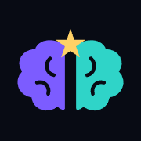

<div align="center">



# Brain Battle

**A real-time multiplayer quiz game in Arabic and English.**

Challenge a friend, join a room, or team up, and find out who knows the most.


[العربية](#العربية)

</div>

## Features

- **Four ways to play:** solo practice, one-on-one duels, free-for-all rooms, and team matches
- **Quick matches:** find an opponent instantly, or invite friends with a room code
- **Nine categories:** math, science, history, geography, nature and the body, arts and literature, sports, pop culture, and general knowledge
- **Two languages:** full Arabic and English support, including right-to-left layout
- **Leaderboards:** climb the rankings for most wins and highest Brain Level
- **Player profiles:** accounts, avatars, and direct messages
- **Game atmosphere:** battle intros, sound effects, and a built-in Spotify player

## Tech stack

| Area | Technology |
| --- | --- |
| Front end | HTML, CSS, and vanilla JavaScript |
| Accounts and data | Supabase Auth, Database, and Storage |
| Server functions | Supabase Edge Functions |
| Music search | Spotify, through an Edge Function |

## Getting started

The game is a static site, so any local web server can run it:

```bash
git clone https://github.com/rvliex2022-max/Brain-Battle.git
cd Brain-Battle
npx serve
```

Then open the address shown in your terminal.

## Project structure

```text
index.html               The game
login.html, signup.html  Sign in and create an account
verify.html              Email verification
Profile Page.html        Player profile
Message.html             Direct messages
settings.html            Player settings
questions-bank.js        Question bank by category
general-questions.js     General knowledge questions
generate-questions.js    Script that builds the question bank
match-found.js           Battle start screens
game-sounds.js           Sound effects
spotify-player.js        Music player
supabase/functions/      Server functions
Photo/                   Avatars and images
```

---

<div dir="rtl">

## العربية

**Brain Battle** لعبة مسابقات جماعية مباشرة بالعربي والإنجليزي. تحدَّ صديقك، أو ادخل غرفة، أو العب مع فريق، وشوف مين يعرف أكثر.

- **أربعة أنماط للعب:** تدريب فردي، ومواجهة واحد ضد واحد، وغرف مفتوحة للجميع، ومباريات فرق.
- **مباريات سريعة:** لاقِ خصمًا فورًا، أو ادعُ أصحابك بكود الغرفة.
- **تسعة تصنيفات:** الرياضيات، والعلوم، والتاريخ، والجغرافيا، والطبيعة وجسم الإنسان، والفنون والأدب، والرياضة، والثقافة الشعبية، والمعلومات العامة.
- **لوحات متصدرين:** لأكثر اللاعبين فوزًا وأعلى مستوى ذكاء.
- **ملفات شخصية:** حسابات وصور ورسائل مباشرة.

</div>
